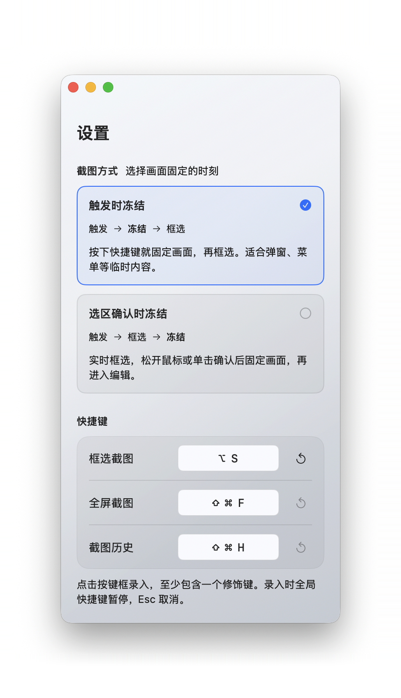
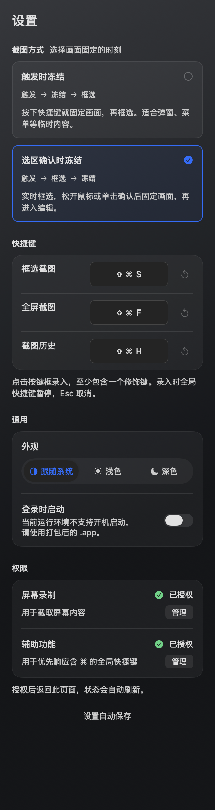
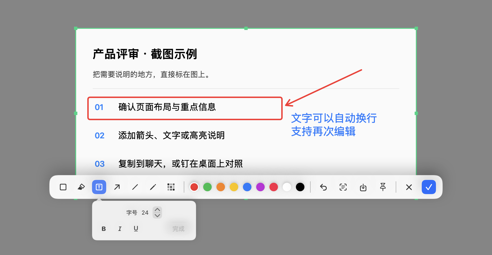

  

<h1 align="center">SnapX</h1>

<strong>截图、标注、取字、钉图，接着你的思路往下走。</strong>

  
  
  

  <a href="https://github.com/FOREST227/SnapX/releases/latest"><strong>下载最新版</strong></a> ·
  <a href="#功能特点">功能特点</a> ·
  <a href="#界面展示">界面展示</a> ·
  <a href="release/v0.5.0/RELEASE.md">v0.5.0 更新说明</a> ·
  <a href="https://github.com/FOREST227/SnapX/issues">反馈问题</a>

SnapX 是一款常驻 macOS 菜单栏的截图工具。选取屏幕上的一块内容，就能原位标注、提取文字、复制、保存，或把图片钉在桌面上对照。适合记录界面问题、整理资料、沟通设计，以及保留临时参考。

## 功能特点

| 功能 | 可以做什么 |
| --- | --- |
| **区域、窗口与全屏截图** | 拖动框选局部，单击高亮窗口，或选择目标屏幕截图；支持多显示器。 |
| **两种截图时机** | 快捷键触发时立即冻结画面，或在选区确认时再冻结，方便捕捉菜单、弹窗和实时画面。 |
| **七种标注工具** | 线框、荧光笔、文字、弧线箭头、直线、画笔和马赛克，支持撤销、重做。 |
| **图片文字识别** | 在本机识别简体中文、繁体中文和英文，自动复制结果，也能在结果窗口选择部分文字。 |
| **桌面钉图** | 调整大小、缩放与透明度；双击图钉切换鼠标穿透，穿透时仍可拖动图钉移动窗口。 |
| **截图历史** | 本次运行期间保留最近 50 张截图，支持大图查看、多选、复制、钉住和删除。 |
| **自定义快捷键与外观** | 设置全局快捷键，切换浅色、深色或跟随系统，支持登录时启动。 |
| **智能边缘吸附 · 实验性** | 辅助选框贴合表格线、面板分界及常见圆角气泡，默认关闭，范围可调。 |

### 标注，顺着手势走

**荧光笔**按住鼠标连续涂抹，保留文字与画面的可读性。默认笔刷为 24pt，支持 8–64pt 和透明度调整；同一笔不会因反复经过同一位置而不断加深。

**弧线箭头**根据拖动方向生成平滑曲线，箭头尖端跟随曲线方向。**文字标注**单击即可输入，支持中文输入法、换行、样式调整和双击再次编辑。**马赛克**用于遮挡不希望展示的细节，可调整笔刷大小。

完成后按 Enter 或点击 ✓ 复制图片，也可以保存为 PNG，或直接钉在桌面上。

### 从图片里拿到文字

点击工具栏的识别按钮，蓝色细线从选区顶部向下扫描：两端较快，中部持续慢行，整段约 450ms。识别尚未完成时，按钮继续显示处理中，结果就绪后才会弹出。

识别结果自动复制到剪贴板。结果窗口使用原生文字选择、自动换行和细浮动滚动条，支持复制部分内容或一键复制全部。截图与文字识别均在本机处理。

### 把参考留在眼前

双击钉图左上角的图钉，可以单独开启或关闭这张图片的**鼠标穿透**。开启后只保留蓝色图钉，图片下面的窗口可正常点击；拖动图钉仍能移动图片。

钉图支持 25%–100% 不透明度、滚轮与捏合缩放、双指平移、拖动边框调整大小，以及适配和复制原图。也可按住 Option（⌥）拖动图片来移动窗口。

### 智能边缘吸附（实验性）

在 **设置 → 实验性功能** 中开启后，拖动选框靠近表格线或面板边界时会辅助贴合。开始框选前的蓝色起点提示帮助对齐首个锚点；支持部分常见圆角气泡，完整匹配时外留约 2pt。

- 默认关闭，默认范围 **16pt**，可在 **4–32pt** 调整。
- 按住 **Option（⌥）** 临时关闭吸附，自由框选。
- 这是拖动框选辅助，不会自动选出整张有效表格，也不支持悬停选择软件内部面板。

识别可能受弱对比、密集网格或复杂背景影响，请以实际选框为准。

## 界面展示

### 浅色与深色设置

  
  

这两张是 **v0.3.2 已安装应用的实际截图**，完整保留原图与阴影，仅扩展白色画布以统一尺寸和居中。v0.5.0 延续这一外观，并增加底部实验功能设置、调整说明文字；图中的 ⌥S 是自定义快捷键。

### 截图与原位编辑

编辑器界面演示，内容为示例素材，图示为旧版工具外观。**v0.5.0 的荧光笔已改为连续涂抹，箭头已改为平滑弧线，浅色工具栏也已更新。**

### 桌面钉图

钉图视图与穿透手柄的合成展示，图片为演示素材。

### 截图历史

历史界面演示，图片为示例素材。支持 ⌘ 多选、Shift 连选，按空格查看独立大图。

## 下载与安装

前往 **[GitHub Releases](https://github.com/FOREST227/SnapX/releases/latest)**，选择对应的安装包：

| Mac 类型 | 安装包标识 |
| --- | --- |
| Apple 芯片（M 系列） | `arm64` |
| Intel 芯片 | `x86_64` |
| 两种芯片通用 | `universal` |

打开 DMG，将 `SnapX.app` 拖入“应用程序”；也可以下载 ZIP 解压安装。需要 **macOS 13 或更新版本**。首次启动后，按提示配置屏幕录制与辅助功能权限，应用入口位于菜单栏。

公开安装包尚未经过 Apple 公证。如果系统提示无法验证开发者，请确认下载来自本仓库，再通过“系统设置 → 隐私与安全性”允许打开。更新时先保存当前工作并退出旧版，再替换应用。

## 开始使用

1. 按 **⌘⇧S**，或从菜单栏选择“框选截图”。
2. 拖动选一块区域，或单击高亮窗口。
3. 添加标注后按 **Enter** 复制，或点击保存、钉图、文字识别。

建议先确定截图范围，再添加标注。重新裁剪会清空当前标注，裁剪暂不支持撤销。

| 操作 | 默认快捷键 |
| --- | --- |
| 框选截图 | ⌘⇧S |
| 全屏截图 | ⌘⇧F |
| 截图历史 | ⌘⇧H |
| 切换七种标注工具 | 1–7 |
| 撤销／重做标注 | ⌘Z ／ ⌘Y 或 ⇧⌘Z |
| 完成并复制／退出编辑 | Enter ／ Esc |
| 文字编辑中换行／完成输入 | Enter ／ ⌘Enter |

全局快捷键可在设置中修改。录入时会暂停全局快捷键；错误组合保留在输入框内，可点击警告图标查看原因，按 Esc 恢复上一次有效组合。

## 常见问题

快捷键没有反应怎么办？

确认 SnapX 正在运行，在设置中检查权限和快捷键状态，并避开其他应用占用的组合键。含 ⌘ 的全局快捷键可能需要辅助功能权限；若系统要求重启应用，请退出后重新打开。

图片保存在哪里？历史会一直保留吗？

编辑器的保存按钮将 PNG 写入“下载”文件夹。截图历史仅保留本次运行期间最近 50 张，退出后清空；需要长期保留的内容请保存为文件。

如何更新？支持 Windows 吗？

应用没有内置自动更新，请从菜单中的“GitHub 发布页”下载新版。当前完整应用仅支持 macOS；Windows 适配工程尚未功能对等，见 [Windows 说明](Windows/README.md)。

## 开发与反馈

macOS 主程序使用 Swift、SwiftUI 和 AppKit，没有第三方包依赖。构建、测试、固定本机签名和发布流程见 **[开发文档](docs/DEVELOPMENT.md)**。

欢迎通过 [Issues](https://github.com/FOREST227/SnapX/issues) 反馈问题。建议附上 macOS 版本、芯片类型、SnapX 版本和复现步骤。
